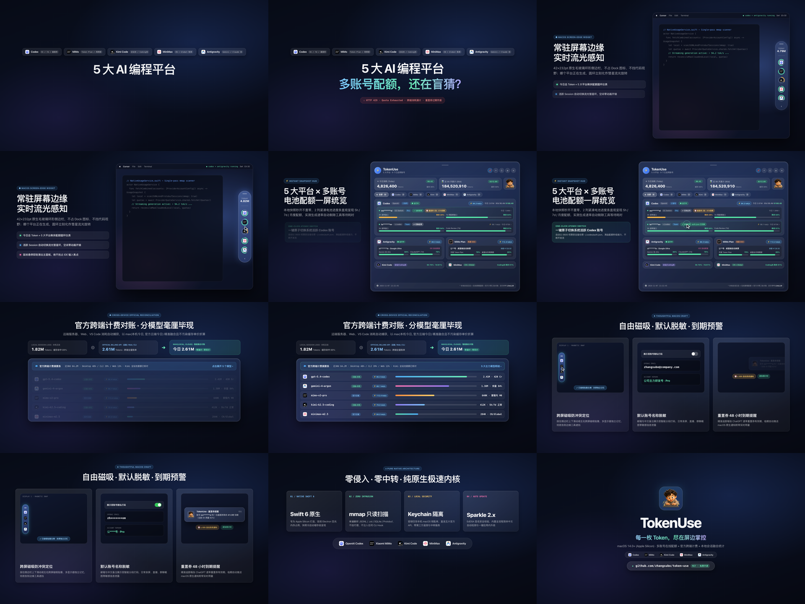
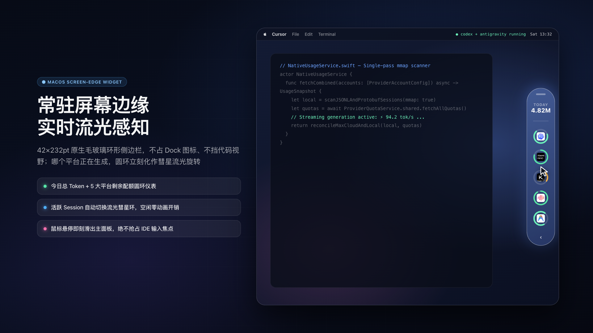
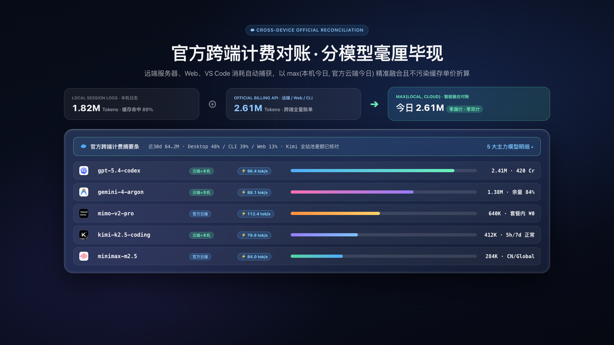
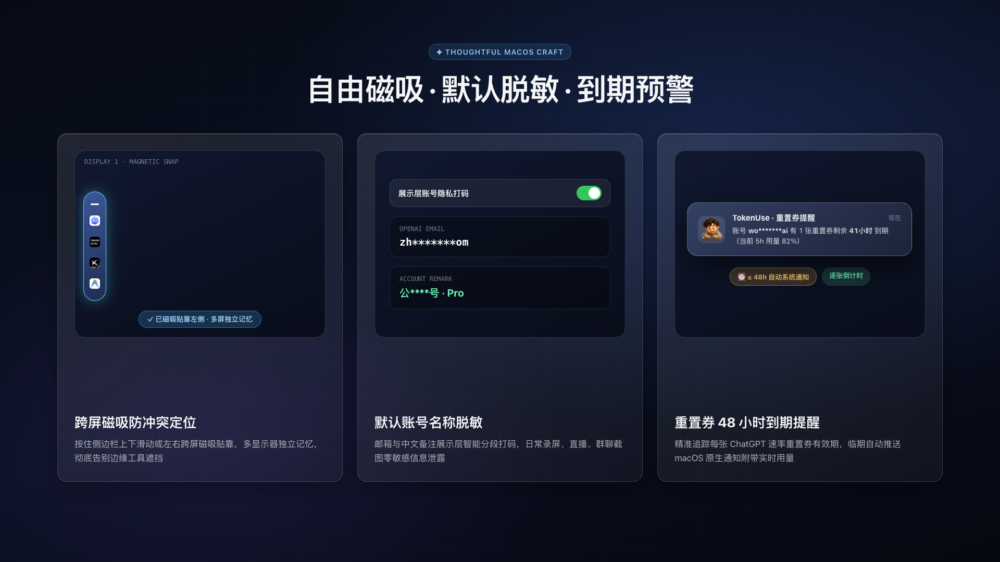
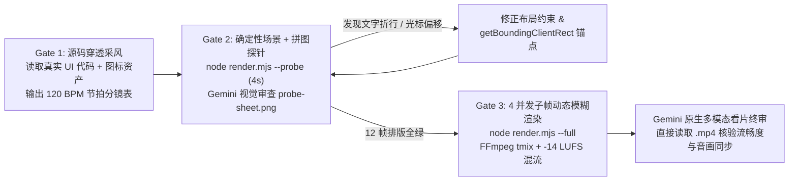

# 01 · Gemini「用代码拍视频」实战方案与方法论拆解

本文档基于对 [`joeseesun/opus-video-prompts`](https://github.com/joeseesun/opus-video-prompts)（54 个案例、18 份完整提示词、9 条技术栈）的系统拆解，结合 **Gemini 百万级上下文源码穿透 + 原生多模态视频/音频审片能力**，整理出一套零外部 `npm` 依赖的 **Gemini 代码视频出片方案**，并使用该方案为 macOS 原生应用 `TokenUse` 制作了 `1920×1080 @ 60fps` 产品介绍视频。

---

## 一、成片与关键帧资产

- **成片规格**：`01-tokenuse-gemini-24s.mp4`（`24.00s`、`1440` 帧、`H.264 yuv420p tv-range` + `48kHz AAC Stereo -14 LUFS`，可通过 [cases/tokenuse-gemini/](../cases/tokenuse-gemini/) 脚本一键复现）
- **交互式舞台预览**：浏览器直接打开 [cases/tokenuse-gemini/index.html](../cases/tokenuse-gemini/index.html) 即可实时拖拽时间轴预览
- **可复用实战手册**：[prompts/gemini-video-playbook.md](../prompts/gemini-video-playbook.md)

### 全片 12 关键帧巡检拼图


### 代表性单帧特写
| 幕次 | 预览图 |
|---|---|
| Scene 1（痛点开场与右侧毛玻璃浮窗） |  |
| Scene 2–3（五大平台配额 HUD 与一键原子热切） |  |
| Scene 4（跨端 Token 计费对账与明细展开） |  |
| Scene 5（跨屏磁吸、隐私打码与 48h 过期预警） |  |
| Scene 6（Swift 6 原生指标卡点与开源尾版） |  |

---

## 二、`opus-video-prompts` 深度拆解：代码生成视频为什么能出商业质感？

复盘仓库全部 54 个案例（涵盖 `@twoclipping (zero)` 的高收藏万能模板 `#15`/`#16`、`Danny Stuart` 的 SaaS 发布片 `#12`/`#13`、`WY` 的科普长片 `#09` 等），其核心认知是：**大模型写代码擅长的是「精确排版、数学曲线、UI 状态机与节拍同步」，而非拟真人物实拍。**

### 1. 技术路线选型矩阵（按性价比排序）

| 场景类型 | 推荐技术栈 | 取舍建议 |
|---|---|---|
| **SaaS / 桌面软件产品宣传片、动态字效** | **单文件 HTML/CSS/SVG + Chrome CDP 截帧 + FFmpeg** | **主力首选**。零脚手架开销，字体渲染、毛玻璃、圆角阴影与真实 UI 100% 同源 |
| **数据可视化 / 几何粒子 / 示波器** | **HTML5 Canvas 2D + 确定性伪随机种子** | 适合局部嵌入 HUD 曲线或音频波形，务必固定 PRNG 种子保证多进程截帧一致 |
| **3D 相机运镜 / 空间翻转** | **Three.js / WebGL** | 仅在确需真三维体积或 PBR 材质时启用；普通卡片翻转用 CSS `perspective` 即可 |
| **多镜头模板复用 / 团队工程化** | **Remotion (`useCurrentFrame` + `spring`)** | 适合长期维护视频流水线；单次出片容易拖入数百 MB `node_modules`，不如原生 CDP 轻快 |
| **数学推导 / 算法科普** | **Manim (Python)** | 公式与几何变换王者，但不适合现代毛玻璃桌面 UI 还原 |

### 2. 决定成片上限的 7 条工程铁律

1. **纯时间函数 `window.seek(t)`（严禁异步动画）**  
   所有元素的位置、透明度、缩放、圆环进度、数字滚动与光标轨迹，必须**唯一由当前秒数 `t` 闭式算出**。彻底禁用 CSS `transition`、`@keyframes`、`requestAnimationFrame` 自增状态和 `setTimeout`，既杜绝截帧丢拍，又支持多进程并行乱序渲染。
2. **闭式二阶阻尼弹簧（Closed-Form Spring）**  
   抛弃廉价的 `cubic-bezier` 回弹，统一采用阻尼比 $\zeta \approx 0.82\text{–}0.86$ 的二阶系统阶跃响应公式，仅保留约 `0.8%` 的微过冲，复刻 Apple Keynote 的克制物理阻尼感。
3. **BPM 节拍网格锁死剪辑与音效峰值**  
   以 `120 BPM`（`1 拍 = 0.5s`，`1 小节 = 2.0s`）建立时间轴：硬切（Hard Cut）严格落在小节重拍，UI 点击落在正拍；音效以其**振幅峰值偏移（Peak Offset）**对齐动作触发时刻，而不是将 WAV 头部简单对齐。
4. **显式 `<banned>` 反 AI 塑料感清单**  
   明确封禁：粒子爆炸、RGB 色差故障、霓虹泛光汤、镜头光晕、透视网格地板、大标题句末句号、卡通果冻抖动。
5. **Chromium 合成器避坑红线**  
   - 严禁在执行 `transform: scale(...)` 的父层挂 `will-change: transform`，否则 Chrome 会将其缓存为低分辨率位图导致文字放大发糊。
   - 严禁在 `transform-style: preserve-3d` 容器上直接设置 `opacity < 1` 或 `filter`，否则浏览器规范会强制拍扁 3D 空间。
6. **子帧超采样快门动态模糊（Subframe `tmix`）**  
   60fps 纯净 CG 画面若无运动模糊会有生硬的“PPT 感”。在每个镜头切点边界 `[sceneStart, sceneEnd)` 内对每帧超采样 `[t - Δt, t, t + Δt]` 3 个子帧，经 `ffmpeg tmix=frames=3:weights='1 2 1'` 合成真实 170° 快门动态模糊，同时避免跨镜头融合残影。
7. **运行时 DOM 几何实测（拒绝盲猜坐标）**  
   鼠标点击按钮、波纹扩散中心必须在 `window.seek(t)` 内通过 `getBoundingClientRect()` 实时读取目标控件中心点，彻底消灭手写硬编码像素导致的“点歪”事故。

---

## 三、面向 Gemini 定制升级的「3-Gate 多模态代码视频方案」



| 能力维度 | `opus-video-prompts` 原方案 | **Gemini 定制方案** |
|---|---|---|
| **1. 原生视频 + 音频终审（杀手锏）** | 只能截静态单帧看排版，动态卡顿、跨镜残影、音画错位无法自检 | **Gate 3 直接将渲染好的 `.mp4` 喂入 Gemini 视觉/听觉多模态模型**，逐秒检查弹簧速率、快门模糊、转场切点与配乐卡点 |
| **2. 百万上下文源码级复刻** | 需要人工截图或手写冗长 UI 描述，易做出通用 SaaS 模板感 | 直接读取项目源码与真实图标资产，1:1 复刻真实产品细节 |
| **3. 零外部 npm 依赖渲染管线** | 依赖 `playwright` 或 `remotion` 下载数千文件与浏览器镜像 | 利用 **Node 原生 `WebSocket` 直连本机 Chrome CDP** + **Python 标准库 `wave` + `numpy` 合成音轨**，`npm install` 为 **0** |
| **4. 中英混排（CJK）防崩护栏** | 英文模板改中文极易出现单字孤行、徽章换行、数字跳动 | 内置 `tabular-nums` 等宽数字、`white-space: nowrap` 胶囊保护、安全边距 `110px` 与中文字重字距补偿 |

---

## 四、可直接复制的 Gemini 视频提示词模板

```markdown
请阅读当前项目的 README、核心 UI 源码与真实图标资源，在 `promo-video/` 目录下用零 npm 依赖方案（单文件 `index.html` 纯函数 `window.seek(t)` + Python `wave/numpy` 合成 120 BPM 配乐音效 `audio.py` + Node 原生 WebSocket 直连本机 Chrome CDP 多标签并发超采样渲染器 `render.mjs`）制作一支 24 秒、1920×1080 @ 60fps 的商业级产品介绍视频。

硬性要求：
1. 严禁 CSS transition/@keyframes/定时器，所有动画用闭式阻尼弹簧（zeta=0.84）按秒数 `t` 计算；严禁粒子爆炸、RGB 故障、霓虹泛光与缩放层 `will-change`。
2. 100% 内嵌项目真实图标与真实业务数据，光标点击位置用 `getBoundingClientRect()` 动态取中心，数字统一开启 `tabular-nums`。
3. 先跑 `--probe` 生成 `3×4` `probe-sheet.png` 拼图并用视觉工具自检中英文排版与光标精度；修净后再跑 `--full`（含镜头内 3 子帧 `tmix` 快门动态模糊与 `-14 LUFS` 响度标准化、`yuv420p tv` 色域），最后直接读取 `.mp4` 成片完成多模态终审。
```
