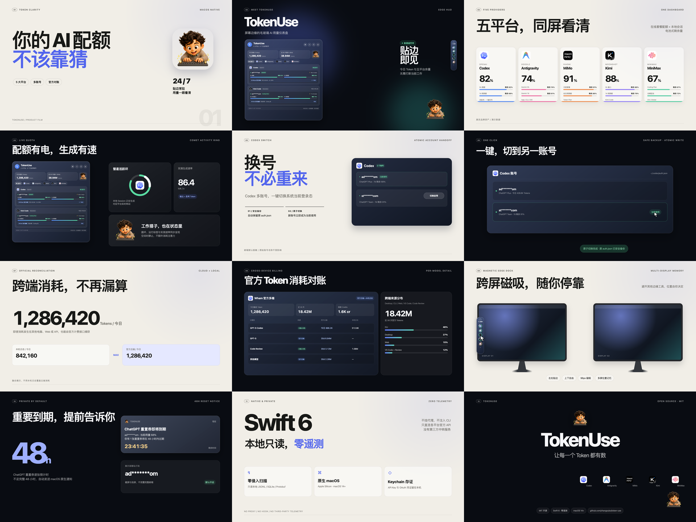
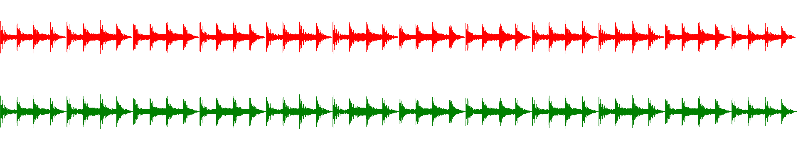
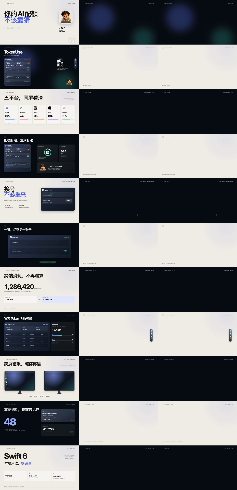
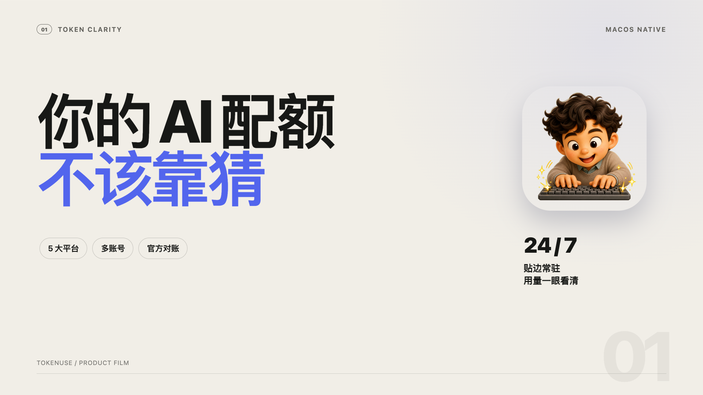
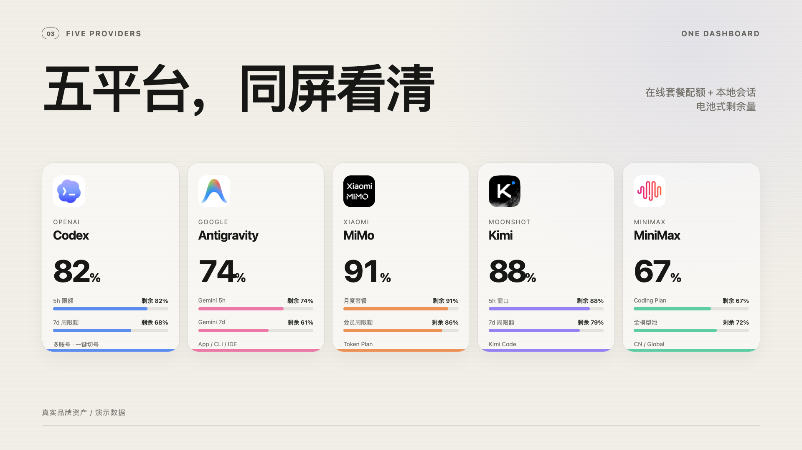
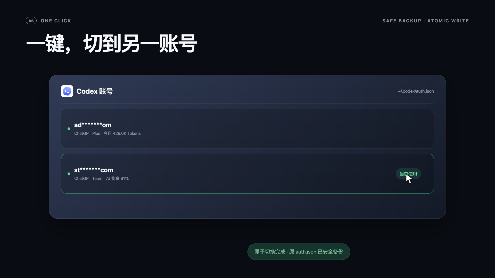
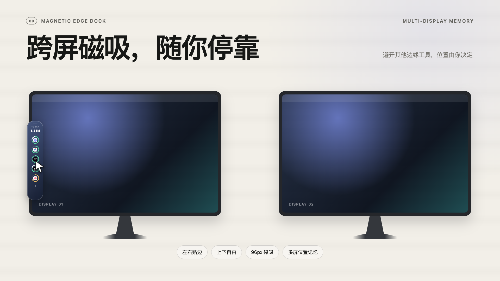
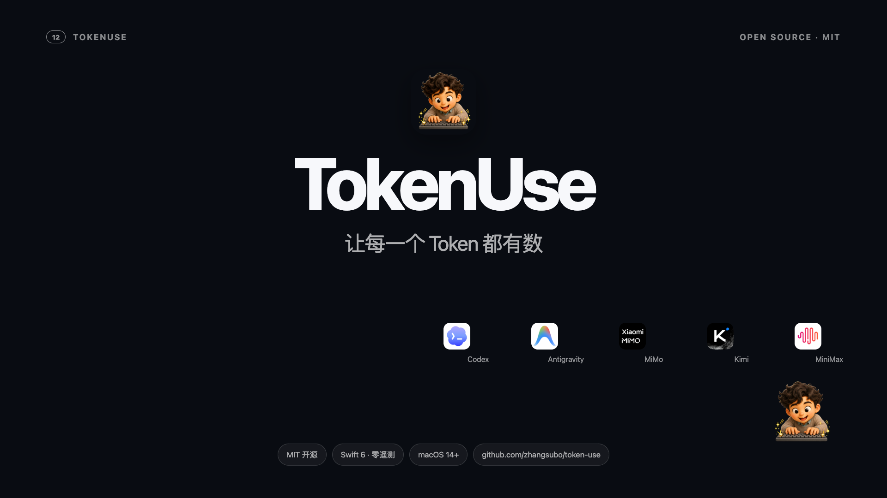

# 02 · Kimi Code「用代码拍视频」实战方案（Orca 编排）

本文档针对 **Kimi Code CLI（`kimi-code/k3.1-pro`，默认 `always_thinking: max`）** 的真实模态能力边界（具备 `image_in` + `video_in`，无 `audio_in`），设计出一套 **Kimi 专属代码渲染视频方案**，并通过 **Orca CLI** 调度本机 Kimi Code 智能体从零独立完成了瑞士杂志大字昼夜交替风格的 `TokenUse` 产品介绍片。

---

## 一、成片与多模态质检图谱

- **成片规格**：`02-tokenuse-kimi-24s.mp4`（`24.000s`、`1440` 帧、`H.264 yuv420p BT.709 tv-range` + `48kHz AAC Stereo -14.7 LUFS`，可通过 [cases/tokenuse-kimi/](../cases/tokenuse-kimi/) 脚本一键复现）
- **交互式舞台预览**：[cases/tokenuse-kimi/index.html](../cases/tokenuse-kimi/index.html)
- **可复用手册与导演角色**：[prompts/kimi-video-playbook.md](../prompts/kimi-video-playbook.md)、[prompts/kimi-video-director.md](../prompts/kimi-video-director.md)

### Gate 2：全片 12 小节巡检联络表


### Gate 1：声波视觉化卡点图（弥补无 `audio_in`）


### Gate 3：全部 11 个硬切点前后帧零残影验证图


### 代表性单帧特写
| 幕次 | 预览图 |
|---|---|
| Bar 01 暖白杂志幕（「你的 AI 配额，不该靠猜」） |  |
| Bar 03 五平台同屏 Bento 幕 |  |
| Bar 06 曜石实机幕（一键原子切号 + `auth.json` 备份提示） |  |
| Bar 09 双显示器跨屏磁吸幕 |  |
| Bar 12 品牌收尾幕（「让每一个 Token 都有数」） |  |

---

## 二、为什么 Kimi 需要独立定制方案？

| 对比维度 | Claude Opus 5.5 | Gemini 方案 | **Kimi 方案（via Orca）** |
|---|---|---|---|
| **多模态能力边界** | 仅 `image_in` | `image_in` + `video_in` + `audio_in` | 原生具备 **`image_in` + `video_in`**（`ReadMediaFile` 直接看 `.mp4`），但**无 `audio_in`** |
| **音轨质检策略** | 盲写音频脚本 | 原生听觉多模态审听 | **「声波图 + EBU R128 数值门禁」**：导出 `audio-waveform.png` 看节拍瞬态，配合 `ebur128` 实测响度与真峰值（实跑中自动揪出了 AAC 编码后真峰值微超标与 `loudnorm` `96kHz` 升采样问题） |
| **推理与代码组织** | 单次长文直出 | 百万上下文一次成型 | 默认开启 **`always_thinking: max`**；采用 **4 文件解耦 + 脚本自动抽图标** 避免在输出 Token 中手写 Base64 |
| **导演审美取向** | 硅谷 SaaS 科技模板 | 连续深色毛玻璃桌面流（6 幕 × 4s） | **中文瑞士杂志大字报 + 昼夜交替 Bento 节奏**（12 小节 × 2s，暖白 `#f2efe8` 观点幕 ↔ 曜石黑 HUD 实机幕交替硬切） |

---

## 三、Kimi 四模块解耦架构与 Orca 调度命令

1. **`build-assets.mjs` → `assets.js`**：自动将真实图标缩略（`sips -Z 320`）并编码至 `window.ASSETS`，零手敲 Base64。
2. **`engine.js`**：经典 `<script src>` 挂载 `window.Engine`（避开 Chrome `file://` 下 ES Module CORS 报错），内置闭式阻尼弹簧 $\zeta \in [0.82, 0.88]$ 与运行时 `getBoundingClientRect()` 靶心计算。
3. **`index.html`**：12 小节昼夜交替舞台与纯函数 `window.seek(t)`。
4. **`audio.py` + `render.mjs`**：Python 标准库 `wave` + `numpy.fft`（禁用 `scipy`）合成配乐与 `audio-waveform.png`；Node 原生 `WebSocket` 直连 Chrome CDP 执行 4 并发 3 子帧 `tmix` 渲染。

### 通过 Orca CLI 编排调用 Kimi Code
```bash
# 1. 将目标项目接入 Orca
orca repo add --path <PROJECT_ROOT> --json

# 2. 启动 Kimi Code 终端智能体并投递导演任务
orca agent launch --agent kimi --surface terminal \
  --worktree "id:<repoId>::<PROJECT_ROOT>" \
  --prompt "<粘贴下方提示词>" --json

# 3. 响应式等待完成
orca terminal wait --terminal <handle> --for tui-idle --timeout-ms 300000 --json
```

### 一键 CLI 触发（配合导演角色文件）
```bash
kimi --yolo --agent-file prompts/kimi-video-director.md \
  -p "请阅读当前项目 README、核心 UI 源码与真实图标，按照 prompts/kimi-video-playbook.md 规范，在 promo-video-kimi/ 下从零制作并验收一支 24 秒 1080p 60fps 产品介绍视频。"
```
