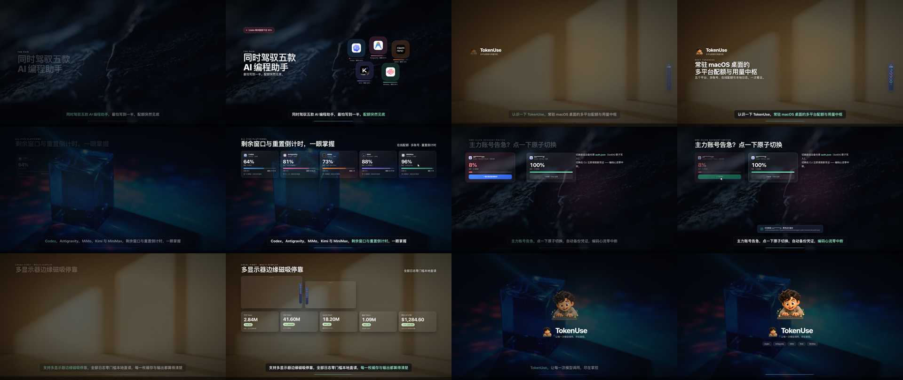
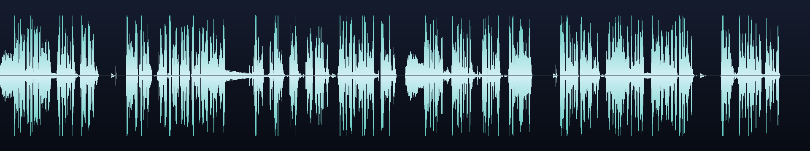
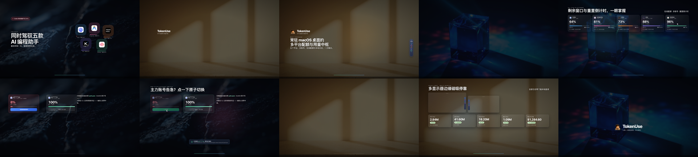
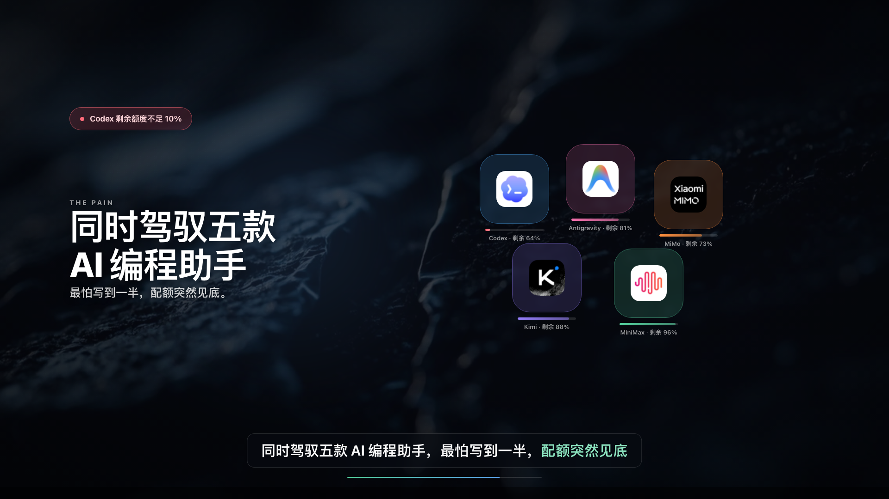
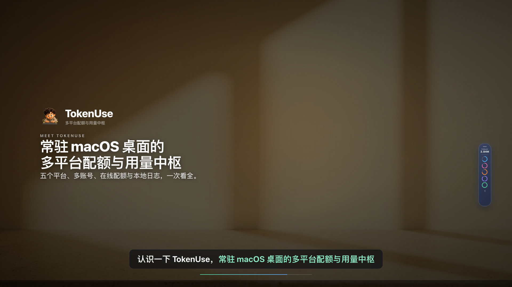
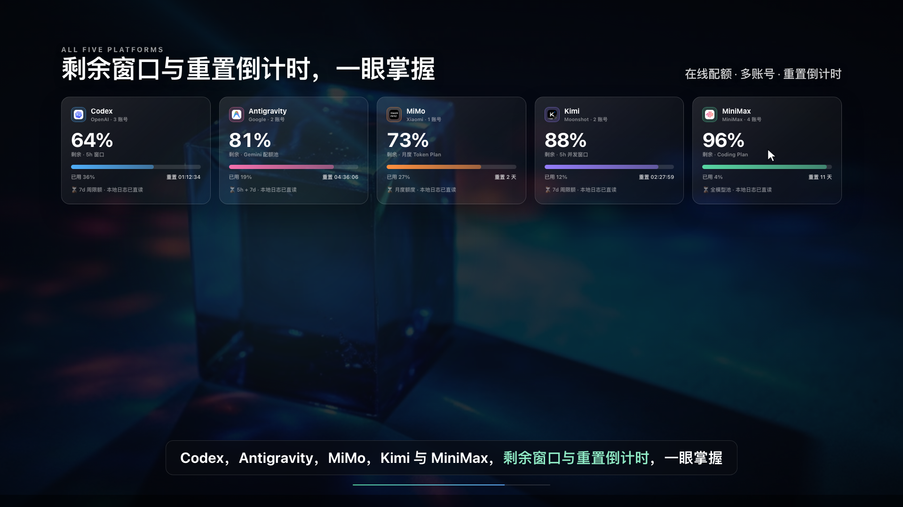
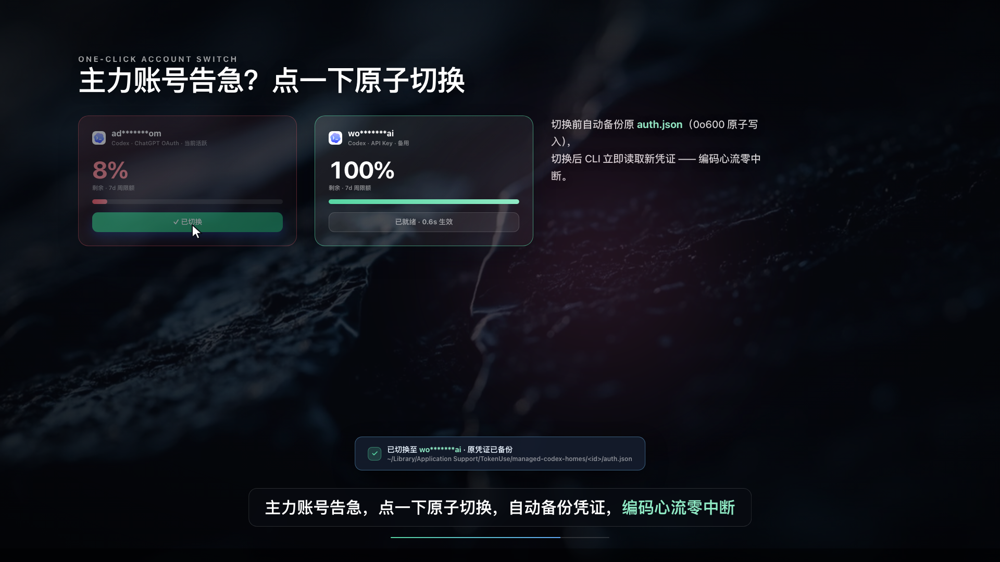
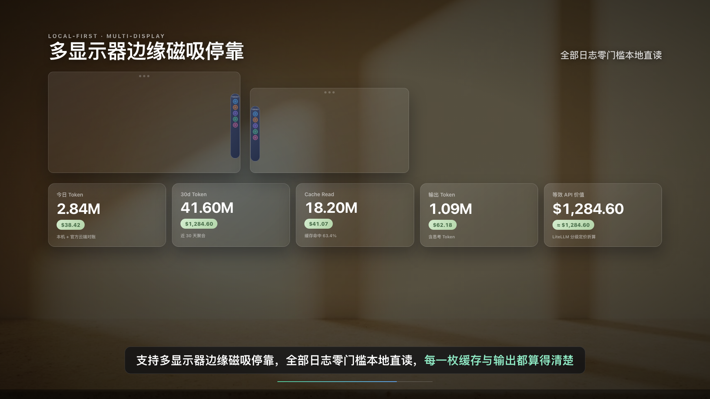

# 03 · MiniMax 三模态「用代码拍视频」实战方案（文字 × 图像 × 语音）

本文档充分发挥 **MiniMax 三模态模型矩阵（`MiniMax-M3` 代码智能体 + `speech-2.8-hd` 毫秒时间戳语音合成 + `image-01` 摄影级图像生成 + 内置 `mcode-tools` 多模态理解套件）** 的组合优势，由本机 MiniMax Code（`mcode`）从零独立完成了 **全中文发布会级配音 + AI 光学摄影背景 + 100% 确定性代码 UI** 的 `TokenUse` 产品介绍大片（`44.03s` / `2642` 帧 / `1920×1080 @ 60fps`）。

---

## 一、成片与多模态质检图谱

- **成片规格**：`03-tokenuse-minimax-trimodal-44s.mp4`（`44.033s`、`2642` 帧、`H.264 High yuv420p tv-range` + `48kHz AAC Stereo -14.6 LUFS / -2.5 dBTP`，可通过 [cases/tokenuse-minimax/](../cases/tokenuse-minimax/) 脚本一键复现）
- **交互式舞台预览**：[cases/tokenuse-minimax/index.html](../cases/tokenuse-minimax/index.html)
- **可复用手册与导演指令**：[prompts/minimax-video-playbook.md](../prompts/minimax-video-playbook.md)、[prompts/minimax-video-director.md](../prompts/minimax-video-director.md)
- **MiniMax 原始执行自检报告**：[cases/tokenuse-minimax/mcode-final-report.md](../cases/tokenuse-minimax/mcode-final-report.md)

### Gate 2：全片 12 帧探针联络表（经 `mcode-tools` 视觉复审通过）


### Gate 1：44 秒母带波形图（6 段发布会旁白 + `-7.5dB` 包络闪避底乐 + 9 处交互拟音）


### Gate 3：全部 5 个分镜切点前后帧零残影验证图


### 六幕关键帧特写
| 幕次 | 预览图 |
|---|---|
| Scene 1 痛点开场（`obsidian-wave` 曜石底板 + 毫秒高亮字幕） |  |
| Scene 2 主角登场（`warm-studio` 北欧暖光底板 + 48pt 悬浮胶囊） |  |
| Scene 3 五平台同屏（`aurora-prism` 蓝宝石棱镜底板 + 五平台电池剩余量） |  |
| Scene 4 原子切号（弹簧光标点击切换 + 安全区 `auth.json` 备份 Toast） |  |
| Scene 5 跨屏磁吸与本地统计（双屏吸附 + 等宽数字统计面板） |  |
| Scene 6 品牌收尾（吉祥物主角定格 + 五平台标签列阵） |  |

---

## 二、MiniMax 三模态核心架构创新

纯单模态代码视频长期受限于**「无真人旁白的默片感」**与**「纯 CSS 渐变背景缺乏摄影级光影质感」**；而纯 AI 视频生成模型又无法保证小字号 UI 数字与图标 100% 不乱码。MiniMax 三模态通过两大机制彻底打通闭环：

### 1. Voice-First 声画锁相环（`speech-2.8-hd` + `subtitle_enable: true`）
- 先调用 `POST https://api.minimaxi.com/v1/t2a_v2`（音色 `Chinese (Mandarin)_Gentleman`，`speed: 1.05`）并发合成 6 段中文旁白（共 `212` 字，净语音 `38.15s`，API 挂钟耗时仅 `2.25s`）。
- 解析 `subtitle_file` 返回的**毫秒级时间戳（`time_begin` / `time_end`）**，在每幕前后留出自然气口，自动生成全局唯一时间轴真值源 [timeline.js](../cases/tokenuse-minimax/timeline.js)（`44.033s` / `2642` 帧）。
- [audio_mix.py](../cases/tokenuse-minimax/audio_mix.py) 计算干声平滑包络（Attack `25ms` / Release `280ms`），当旁白说话时将电钢琴底乐自动压低 `-7.5dB`（Sidechain Ducking），停顿与转场处自然回升。

### 2. 三明治光学合成架构（`image-01` × 确定性 HTML/SVG UI）
- **Layer 0（AI 光学摄影底板）**：并发调用 `image-01` 生成 3 张严禁含文字或 UI 的 `1920×1080` 底板（[obsidian-wave.jpg](../cases/tokenuse-minimax/backdrops/obsidian-wave.jpg)、[warm-studio.jpg](../cases/tokenuse-minimax/backdrops/warm-studio.jpg)、[aurora-prism.jpg](../cases/tokenuse-minimax/backdrops/aurora-prism.jpg)），在 `window.seek(t)` 中赋予极克制的微推镜。
- **Layer 1（高对比度光学遮罩 Scrim）**：确保前景文字对比度恒大于 `7:1`。
- **Layer 2（100% 确定性代码界面）**：真实提取项目图标，用闭式阻尼弹簧驱动 UI 交互与实时 `getBoundingClientRect()` 光标。
- **Layer 3（毫秒级同步发布会字幕条）**：锁定 `timeline.js` 分句时间戳实时高亮当前朗读词句。

---

## 三、实跑验证：`mcode-tools` 多模态自愈闭环立下的两次关键功劳

1. **视觉门禁纠偏（`connector__matrix__describe_images`）**：首轮 `probe-sheet.png` 出炉后，MiniMax 视觉理解模型准确指出第 8 格备份 Toast 压住标题、暖光底板白字对比度偏弱；`MiniMax-M3` 随即下移 Toast 至安全区、加深暖幕墨色遮罩并重跑探针通过复审。
2. **听觉门禁捕获纯数值检测盲区（`connector__matrix__videos_understand`）**：首轮成片虽然通过了 `ebur128` 响度数值检测（`-14 LUFS`），但 `videos_understand` 直接听出成片存在“撕裂杂音、人声淹没”；`MiniMax-M3` 据此定位到立体声 WAV 平面序 `(2, N)` 与 `+32768` 直流偏置叠加缺陷，修复为标准交错有符号 `int16` 后，混音与原声相关性从 `0.007` 跃升至 **`0.97 ~ 0.99`**，二轮终审一次性通过。

---

## 四、一键复刻命令

```bash
~/.minimax-code/bin/mcode exec \
  --permission full \
  --model minimax/MiniMax-M3 \
  --cwd <PROJECT_ROOT> \
  --timeout 45m \
  --max-steps 120 \
  --append-system-prompt-file prompts/minimax-video-director.md \
  "请阅读当前仓库 README、核心 UI 源码与真实图标资产，严格遵循 prompts/minimax-video-playbook.md 的「Voice-First 声画锁相环 + 三明治光学合成 + mcode-tools 三道门禁」，调用 MiniMax speech-2.8-hd、image-01 与确定性 HTML/CSS/SVG 渲染管线，在 promo-video-minimax/ 下独立制作并验收一支 1080p 60fps 有声产品介绍大片。"
```
